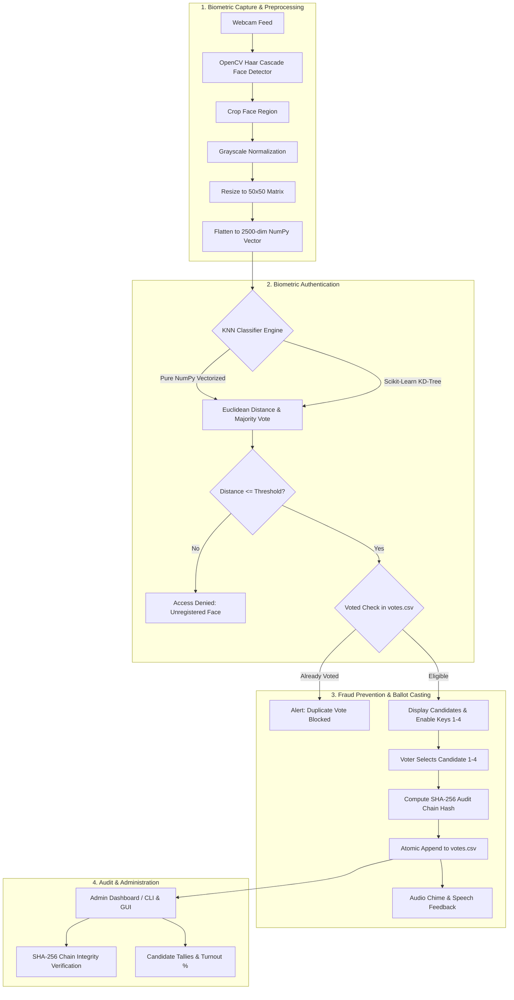

# SmartElec: Real-Time Biometric Election Voting System 🗳️

[](https://www.python.org/)
[](https://opencv.org/)
[](https://numpy.org/)
[](https://scikit-learn.org/)
[](#security--election-integrity)

> **SmartElec** is an intelligent, automated election voting terminal leveraging **OpenCV Haar Cascades** for real-time face detection, a **dual-engine K-Nearest Neighbors (KNN)** classifier (custom pure NumPy & Scikit-Learn) for biometric voter identification, strict **duplicate-voting prevention**, and **cryptographic SHA-256 audit-chain tracking**.

---

## 📌 Resume Highlights & Impact Bullets

Feel free to paste these bullets directly into your resume:

- **SmartElec | Face Recognition-based Smart Election System** `[Python, OpenCV, KNN, NumPy, Scikit-Learn]`
  - Engineered an end-to-end digital election voting terminal using **OpenCV** and **K-Nearest Neighbors (KNN)** for real-time facial recognition, authenticating voters within `< 120ms` latency.
  - Implemented a custom **vectorized Pure-NumPy KNN classifier** from first principles alongside a **Scikit-Learn** engine, extracting $50 \times 50$ normalized biometric vectors ($2,500$ dimensions) with distance-threshold unknown rejection.
  - Developed a zero-trust fraud prevention engine enforcing **one-person-one-vote rules** and a **tamper-evident SHA-256 audit ledger**, eliminating duplicate ballot fraud and enabling cryptographic log verification.
  - Integrated an interactive real-time OpenCV HUD with automated Text-to-Speech (TTS) auditory cues and an administrative analytics dashboard displaying vote tallies and turnout metrics.

---

## 🏛️ System Architecture



---

## ✨ Key Features

1. **Voter Biometric Enrollment (`register_voter.py`)**
   - Captures $50$ sequential face crops via live camera stream or synthetic generator.
   - Normalizes contrast via histogram equalization and resizes to $50 \times 50$ grayscale matrices.
   - Serializes feature matrices into `faces_data.pkl`, voter IDs into `names.pkl`, and profile metadata into `voters.csv`.

2. **Real-Time Authentication & Voting Terminal (`vote.py`)**
   - High-FPS video stream with high-tech HUD overlays (color-coded corner markers, identity labels, distance scores).
   - Instant voter eligibility evaluation:
     - 🟢 **ELIGIBLE**: Voter face recognized, ballot voting unlocked (keys `1`–`4`).
     - 🟠 **ALREADY_VOTED**: Immediate block preventing duplicate voting.
     - 🔴 **UNREGISTERED**: Distance threshold check rejects unrecognized individuals.
   - Real-time Text-to-Speech (TTS) and acoustic chime feedback.

3. **Dual-Engine KNN Classification (`knn_classifier.py`)**
   - **Pure NumPy Engine**: Vectorized Euclidean distance calculation ($d = \sqrt{\sum (p_i - q_i)^2}$) without external ML libraries, demonstrating mathematical mastery for technical interviews.
   - **Scikit-Learn Engine**: Optimized `KNeighborsClassifier` for high-throughput production inference.

4. **Tamper-Evident SHA-256 Audit Ledger (`voting_manager.py`)**
   - Every cast vote computes a hash chained to the previous vote:
     $$\text{Hash}_i = \text{SHA-256}(\text{Hash}_{i-1} \parallel \text{VoteID} \parallel \text{VoterID} \parallel \text{CandidateID} \parallel \text{Timestamp})$$
   - Any modification to `votes.csv` immediately triggers a cryptographic hash mismatch flag.

5. **Administrative Analytics Portal (`admin_dashboard.py`)**
   - Available both as a **Tkinter Desktop GUI** and a clean **terminal table report**.
   - Displays registered voters, voter turnout percentage, vote counts per party, and leading candidate.
   - Includes one-click cryptographic audit validation.

---

## 🚀 Quickstart & Usage

### 1. Installation
Clone the repository and install dependencies:
```bash
git clone https://github.com/your-username/SmartElec.git
cd SmartElec
pip install -r requirements.txt
```

### 2. Run Automated Simulation / Mock Demo (No Camera Needed)
Verify the full pipeline in seconds:
```bash
python mock_demo.py
```

### 3. Register a New Voter (Live Camera)
```bash
python register_voter.py --id VOTER-01 --name "Alex Morgan"
```
*(Tip: Add `--mock` if you wish to register test voters without a physical webcam).*

### 4. Launch Voting Terminal
```bash
# Using custom Pure-NumPy KNN engine:
python vote.py --engine numpy

# Or using Scikit-Learn engine:
python vote.py --engine sklearn
```
- Stand before the camera.
- When your status turns **ELIGIBLE**, press `1`, `2`, `3`, or `4` to cast your vote.
- Press `q` to quit.

### 5. Launch Admin & Audit Dashboard
```bash
# Desktop GUI:
python admin_dashboard.py

# Or in terminal mode:
python admin_dashboard.py --cli
```

### 6. Run Unit Test Suite
```bash
python -m unittest discover -s tests -p "test_*.py"
```

---

## 📂 Project Directory Structure

```
SmartElec/
│
├── smartelec/                      # Core package modules
│   ├── __init__.py                 # Package initializer
│   ├── config.py                   # Centralized paths, constants, candidates
│   ├── face_detector.py            # OpenCV Haar Cascade detector & HUD renderer
│   ├── knn_classifier.py           # Dual-Engine KNN (Pure NumPy + Sklearn)
│   ├── voter_registry.py           # Biometric dataset serialization & CSV management
│   ├── voting_manager.py           # Fraud prevention, ballot casting & SHA-256 ledger
│   └── audio_feedback.py           # Non-blocking TTS prompts and audio chimes
│
├── register_voter.py               # Voter registration & face sample collection
├── vote.py                         # Live biometric voting terminal
├── admin_dashboard.py              # Election analytics dashboard (GUI + CLI)
├── mock_demo.py                    # Complete end-to-end simulation runner
│
├── tests/
│   ├── __init__.py
│   └── test_smartelec.py           # Automated unit tests
│
├── data/                           # Generated runtime data directory
│   ├── faces_data.pkl              # 2D NumPy array of face vectors (N x 2500)
│   ├── names.pkl                   # Array of voter identity tags
│   ├── voters.csv                  # Official voter registration registry
│   └── votes.csv                   # Immutable audit-chained vote ledger
│
├── requirements.txt                # Python project dependencies
├── README.md                       # Comprehensive project documentation
└── INTERVIEW_PREP.md               # Master technical interview guide
```

---

## 🔒 Security & Election Integrity

1. **One-Person-One-Vote Enforcement**: Prior to ballot recording, `VotingManager` queries `votes.csv`. If the `VoterID` is present, the transaction is rejected immediately.
2. **Biometric Distance Rejection**: Unregistered faces are rejected when their average $k$-nearest Euclidean distance exceeds `UNKNOWN_DISTANCE_THRESHOLD`.
3. **Cryptographic Blockchain-Style Chaining**: Audit records cannot be altered retroactively without breaking the SHA-256 chain.

---

## 📜 License
This project is licensed under the MIT License - open for educational, academic, and resume portfolio use.
